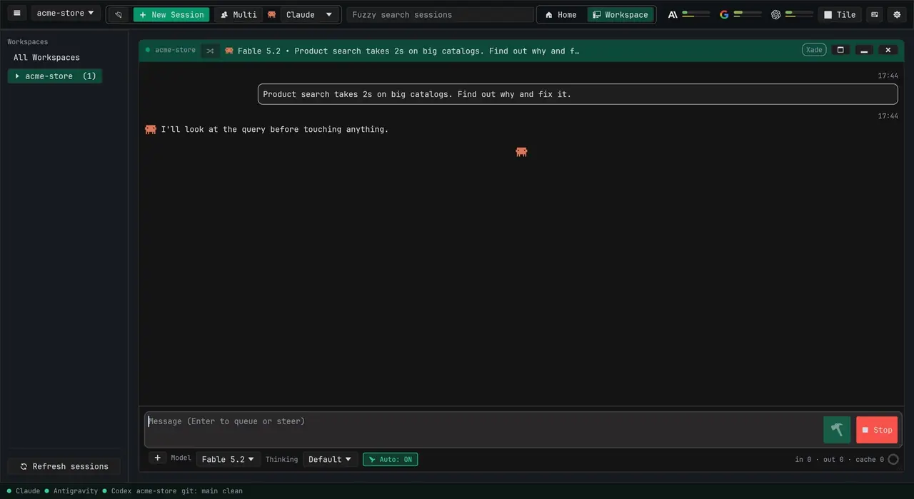

<p align="center"></p>

# Xade

[](https://github.com/juliomatcom/xade/actions/workflows/ci.yml)

**Your coding agents, side by side or on one team.** Run them in separate windows, or let them plan, build and review together, in a native Rust app with no Electron. **100% free and open source (MIT), no subscription required.**

Works with Claude Code, Codex and Antigravity. OpenCode and local models are coming soon.

<p align="center"><a href="https://xade.pro/"></a></p>

## Why Xade

- **A team of models.** A [Multi-Session](docs/multi-session.md) puts several models in one window and one folder. Message all of them or one `#handle`, and they hand work to each other.
- **Native Rust.** A GPU-rendered app, with no Electron and no web runtime.
- **Your setup, as is.** Xade drives your installed Claude Code (`claude`), Codex (`codex`) and Antigravity (`agy`) CLIs: your login, settings, instruction files, MCP servers, skills and permission rules all apply. No Xade account and no API keys to paste.
- **Hit a limit? Switch providers.** Fork a session to another provider; the new agent starts from a summary of the work.
- **No telemetry.** Session history is saved on your machine. The agents still send prompts and code to their model providers.

**Simple. Opinionated. Really fast.** Xade does one thing well, makes the choices for you, and never trades speed for features. These three rules lead every change to the project.

## What else it does

- Run multiple sessions in side-by-side windows.
- Import and resume your existing Claude Code and Codex sessions.
- Search saved sessions. Typos are fine in titles.
- Review code changes in a side-by-side diff before they are applied, and open any file in VS Code.
- Turn auto-approve on or off per session. With it on, changes still show up for review afterwards.
- See usage quota in the top bar for providers that report it, with reset times on hover.
- Pick the model and effort level, and see context and token meters.
- Select message text to copy or quote it into the prompt. Links in chat open in your default browser.
- The git branch and changed-file count stay visible in the bottom bar.
- Auto mode and the model choice carry over to new sessions.

## How it works

Xade runs the official CLIs you already have installed and logged in, and never reads or touches your credentials: Claude Code over its JSON streaming mode, Codex through `codex app-server` and Antigravity through `agy acp`. Sessions are stored in a local SQLite file.

The name is short for X-provider Agentic Development Environment (pronounced "zade").

## Status

Early MVP. macOS and Linux (x86_64, aarch64). Provider guides: [Codex](docs/codex.md) and [Antigravity](docs/antigravity.md). OpenCode and local models are coming soon.

## Install

### Command line

```sh
curl -fsSL https://raw.githubusercontent.com/juliomatcom/xade/main/scripts/install.sh | sh
```

This installs the latest build: `Xade.app` into `/Applications` on macOS (Apple Silicon), or into `~/.local/share/xade` with a desktop entry on Linux (x86_64 or aarch64). It also installs the `xade` command into `~/.local/bin`; add that folder to your PATH if the script says so. Run the same command again to update.

```sh
xade --help
xade --version
xade <path>    # opens that folder as a workspace in a new window; `xade .` for the current one
```

### Downloads

Builds are published on every push to main at https://github.com/juliomatcom/xade/releases/latest: `Xade-macos-arm64.zip` (unsigned: right-click Xade.app > Open the first time) and `Xade-linux-x86_64.tar.gz` / `Xade-linux-aarch64.tar.gz` (unpack, run `./xade`).

Linux needs a Vulkan-capable GPU driver and, for file dialogs, xdg-desktop-portal.

## Requirements

- At least one agent CLI, installed and logged in: Claude Code (check with `claude auth status`), Codex (`codex login`) or Antigravity (`agy`)
- git
- VS Code with the `code` command (optional, for opening files from the diff view)

## Build and run

Building needs Rust (stable).

```sh
cargo run --release -p xade
```

To install it as a regular macOS app (so you can open it from Launchpad and keep it in the Dock):

```sh
./scripts/bundle-macos.sh            # builds and installs /Applications/Xade.app
```

On Linux, `./scripts/bundle-linux.sh --install` does the same: it builds and installs to `~/.local/share/xade` with a desktop entry, an icon and `~/.local/bin/xade`. Without `--install` it packs `dist/Xade-linux-<arch>.tar.gz` for releases.

Run the script again after pulling changes to update the app.

Xade stores its data in the `xade/` folder inside your OS data directory. To use another location, set `XADE_DATA_DIR`.

## Settings

Settings live in `settings.json` in the data folder; open it with Cmd+, (Ctrl+, off macOS) and changes apply live. Every key, shortcut and theme color is listed in [docs/settings.md](docs/settings.md).

## Development

```sh
cargo test --workspace
```

The demo video and screenshots are recorded from the real app with scripted models. To record them again (needs ffmpeg and ImageMagick):

```sh
./scripts/record-demo.sh
```

Project notes for contributors and AI agents live in `wiki-llm/`. Start at `wiki-llm/index.md`.

## License

MIT. See [LICENSE](LICENSE).

Copyright © 2026 Julio César Martín
