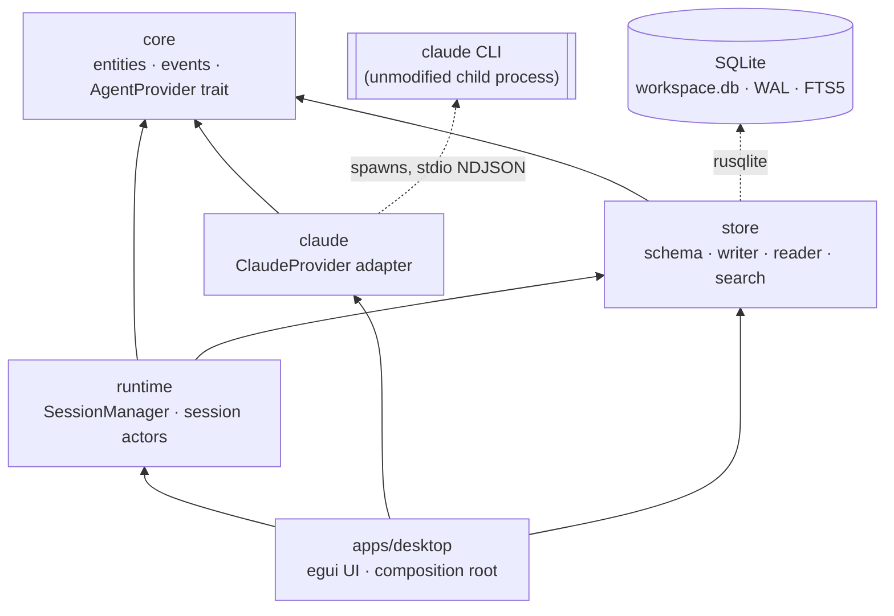
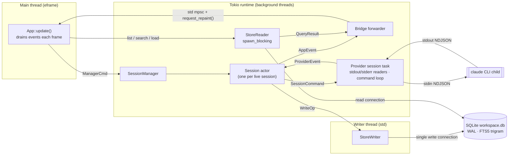
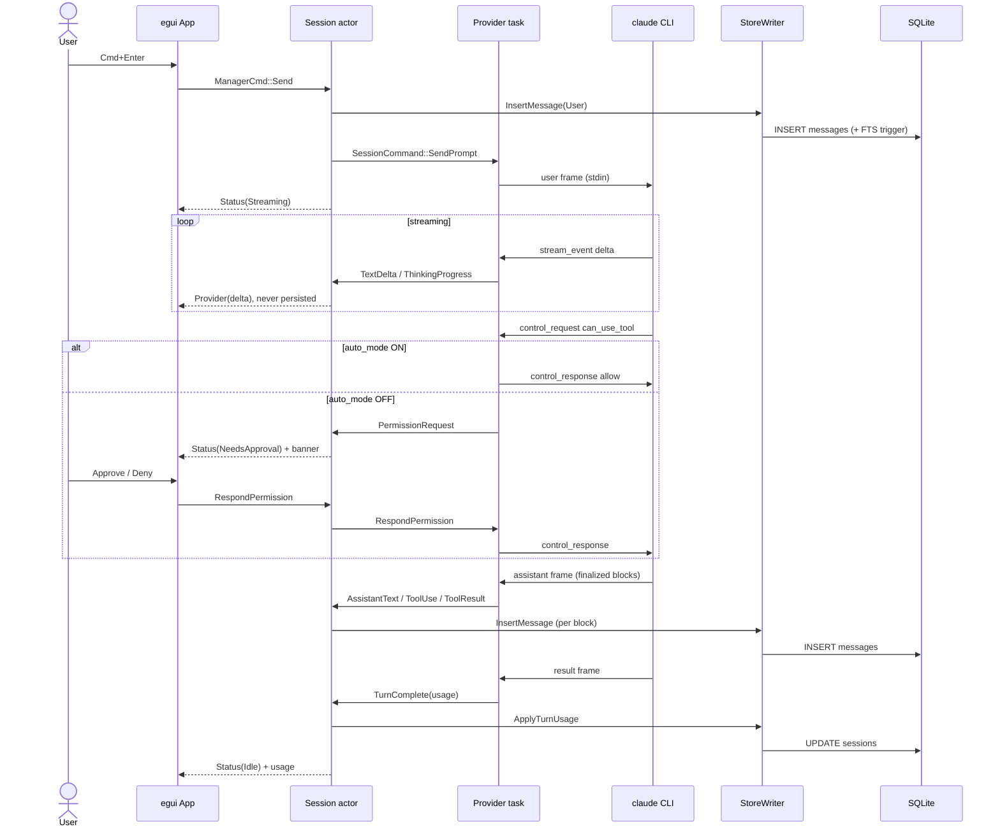
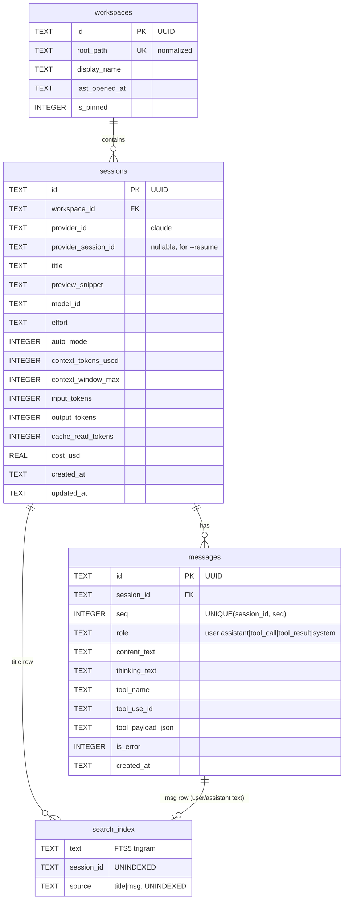
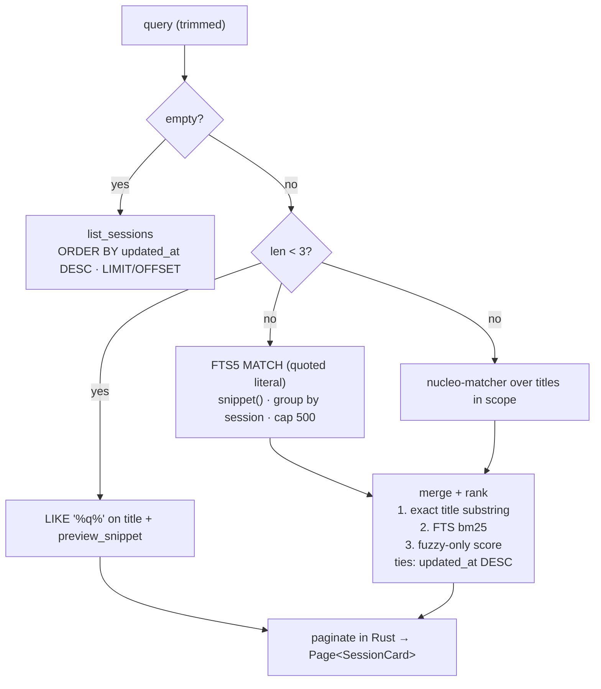

# Xade — MVP Implementation Plan

> Source spec: [`agent_workspace_mvp_specification.md`](agent_workspace_mvp_specification.md). This plan narrows it to a short MVP and is written to be executed phase by phase by Sonnet 5.5 sub-agents. Opus owns Phase 0 and reviews each phase's output.
> Rules live in `wiki-llm/conventions.md` (created in Phase 0). This plan is disposable once the MVP ships; the wiki is not.

---

## 1. Spec review — what changes and why

| # | Spec says | Problem | MVP decision |
|---|---|---|---|
| R0 | Iced (MVU) for the UI | User decision: use **egui** (`eframe`, `wgpu` backend). egui is immediate-mode, so there's no MVU message enum. State lives in one `App` struct that's redrawn each frame. Async work runs on a background tokio runtime and reaches the UI through channels. | egui via `eframe`. See §3.2 for the runtime bridge. |
| R1 | Unbounded canvas of free-floating, draggable, resizable windows + minimize dock | egui's `egui::Window` already provides drag, resize, collapse (which serves as minimize), z-order and close. A dock and snap/tile would be extra work. | Each session is an `egui::Window` inside the central panel. Collapse stands in for minimize. Snapping/tiling (e.g. `egui_tiles`) and a bottom dock are post-MVP. |
| R2 | "Stop" sends `SIGINT` to keep the warm process alive | In `-p` stream-json mode `SIGINT` may end the process. The CLI's stdio control protocol (used by the Agent SDK) has an `interrupt` control request. | Stop = `control_request {subtype:"interrupt"}` on stdin. Signals are used only for shutdown. Verify in the Phase 0 spike. |
| R3 | FTS5 `trigram` gives typo tolerance (insertions, deletions, transpositions) | It doesn't. Trigram MATCH is substring matching: every trigram in the query must be present. | Body text: trigram substring search. Titles: typo-tolerant fuzzy match in Rust (`nucleo-matcher`). See §6. |
| R4 | Four Clean Architecture rings, with Port traits for every outer dependency | A repository trait with one SQLite implementation is an abstraction that buys nothing yet. | Keep the dependency rule and enforce it with crate boundaries (§3). The only trait is `AgentProvider`, because a second vendor is planned. The store is used as a concrete type. |
| R5 | Antigravity (`agy`) adapter, with specific flags | Nothing in the spec verifies these flags, and it doubles adapter work. | Out of scope. `AgentProvider` must not leak Claude types, so `agy` can be added later without touching `core`. |
| R6 | Model/effort changes take effect "via flags or session controls" | How effort is controlled varies by CLI version. | Changing model or effort restarts the process with `--resume <provider_session_id>` before the next turn. One code path, whatever controls the CLI version has. |
| R7 | `rate_limit_event` frames feed a 5h/7d quota bar | We haven't confirmed the CLI emits these frames in stream-json. | The Phase 0 spike checks. If absent, the quota bar is hidden (not faked) and the item is deferred. |
| R8 | `claude auth status` pre-flight | The subcommand may not exist on every version. | The spike confirms the command. Fallback: treat an auth error in the first frames as `NotLoggedIn` and show a banner. |
| R9 | Attachments, `@`-autocomplete, drag-drop, editable titles, highlighted excerpts, page-number pagination with a size selector | These are polish, not core to the MVP loop. | Deferred (§9). The MVP shows plain excerpts and Prev/Next pagination with a fixed page size. |
| R10 | Enterprise ToS compliance is asserted | — | Confirmed in scope by the user (2026-11-23). The hard invariants in `conventions.md` still apply: the app never touches credentials and never modifies the binary. |
| R11 | "Zero orphan processes" | The app can crash before it cleans up. | The child exits on stdin EOF, which happens when the parent dies and the pipe closes. Also set `kill_on_drop(true)` and run an explicit shutdown sequence (§5.4). |

### MVP success criteria (the whole plan is done when all pass, manually, on macOS)
1. Add two directories. Start a Claude session in each from Home. Both stream at the same time in side-by-side windows.
2. Replies render as markdown: a reply with a fenced Rust block, a table and a list shows highlighted code, a grid and bullets, both while streaming and after. While the model thinks, a "Thinking… ~N tokens" indicator shows (the CLI exposes no thinking text). Tool calls show as cards with a status and highlighted input and output.
3. With Auto OFF, a file edit pauses with a banner. Approve, Approve & Auto, and Deny each behave correctly. With Auto ON, no banner appears.
4. Stop ends the current turn. The next prompt in the same window works without a respawn (check that the pid is unchanged).
5. Context meter and usage meter (tokens, cost) update after each turn.
6. Quit the app, relaunch, and search for a word from an old assistant reply. The session is found. Open it: history renders and a new prompt continues the conversation (resume).
7. A typo in a session title (e.g. `refactr`) still finds it.
8. After quitting, `pgrep -f "claude -p"` returns nothing. After `kill -9` of the app, children exit within 2 s.
9. With Auto OFF, an `Edit`/`Write` request opens the diff modal (side-by-side, red/green, line numbers). Accept applies the change; Cancel denies it. With Auto ON, the tool card's "Review changes" opens the same modal read-only. No diff is ever drawn inline in the conversation. "Open in VS Code" opens the file at the first changed line.
10. The bottom status bar always shows the active directory's branch and dirty state. After the agent edits a file, the modified count goes up within about a second of the tool result, without any user action.

---

## 2. Execution protocol

- Run the phases in order: **P0 → P1 → (P2 ∥ P3) → P4 → P5 → P6**. P2 and P3 run in parallel as separate sub-agents.
- Each phase has a **Goal**, **Files**, **Tasks**, **Acceptance** and **Wiki** section. A phase is done when Acceptance passes and the definition of done in `conventions.md` holds.
- Assignment, per `AGENTS.md`: P0 runs on Opus. P1–P6 implementation runs on Sonnet (`model: sonnet`). Wiki line edits go to Haiku (`model: haiku`), which is given the facts by the implementing agent.
- Every Sonnet dispatch gets: this plan's phase section, `wiki-llm/index.md`, `wiki-llm/conventions.md`, and the wiki pages the phase names. Nothing else is assumed.
- Never upgrade or swap a dependency without asking (per `AGENTS.md`). Adding one is fine. Pin exact versions in `Cargo.toml` when first added.

---

## 3. Architecture

### 3.1 Cargo workspace

```
agent-workspace/
  Cargo.toml                # [workspace], shared lints, resolver = "2"
  crates/
    core/                   # entities, events, commands, AgentProvider trait
    claude/                 # Claude CLI adapter (impl AgentProvider)
    store/                  # SQLite: schema, writer thread, queries, search
    runtime/                # use cases: SessionManager (headless, no UI deps)
  apps/
    desktop/                # egui UI + wiring (composition root)
  wiki-llm/
```

Dependency rule (Cargo enforces it, so a wrong import fails to compile). Solid arrows are crate dependencies; dotted arrows are what each crate drives at runtime.



| Crate | May depend on | Key external deps |
|---|---|---|
| `xade-core` (`crates/core`) | — | `serde`, `serde_json`, `uuid` (v4, serde), `thiserror`, `tokio` (feature `sync` only), `time` |
| `xade-claude` (`crates/claude`) | `xade-core` | `tokio` (`process`, `io-util`, `rt`, `macros`, `time`), `serde_json`, `tracing` |
| `xade-store` (`crates/store`) | `xade-core` | `rusqlite =0.43.0` (feature `bundled`, which includes FTS5 and trigram), `nucleo-matcher =0.3.1` |
| `xade-runtime` (`crates/runtime`) | `xade-core`, `xade-store` | `tokio`, `tracing` |
| `xade` (`apps/desktop`) | all | `eframe =0.37.0` (wgpu renderer), `egui_commonmark =0.26.0` (feature `better_syntax_highlighting`), `egui_extras =0.37.0` (feature `syntect`), `similar =3.2.1`, `rfd =0.18.0`, `dirs`, `tokio` (`rt-multi-thread`), `tracing-subscriber` |

`runtime` gets providers injected as `Vec<Arc<dyn AgentProvider>>`. It never names `claude`. Only `xade` constructs `ClaudeProvider`.

### 3.2 Runtime data flow

Components, threads and channels:



One prompt turn, including a manual-mode permission request:



- `main` builds a multi-thread tokio runtime and keeps it alive for the app's lifetime. Then it runs `eframe::run_native` on the main thread, which macOS requires.
- The UI never touches SQLite writes or child processes. It sends `ManagerCmd` (a tokio `UnboundedSender`, safe to call from sync code) and renders `AppEvent`.
- **Bridge:** a forwarder task moves each `AppEvent` onto a `std::sync::mpsc` channel and calls `egui_ctx.request_repaint()`. `App::update` drains that channel with `try_recv` at the top of every frame and folds the events into its state. Never block or `.await` inside `update`.
- Reads (home list, search, history load) are `async fn`s on a `StoreReader` that use `spawn_blocking` on a dedicated read connection. The UI spawns them on the runtime handle. Results come back through the same bridge as `AppEventKind::Query(QueryResult)`, tagged with a request generation so stale results are dropped.
- One writer thread owns the only write connection. All writes go through `WriteOp` on an mpsc channel. WAL mode lets reads run alongside writes.

### 3.3 Core types (`crates/core`)

Use the field names below. Add a field only when a phase needs it.

```rust
pub struct WorkspaceId(Uuid); pub struct SessionId(Uuid);           // newtypes, Copy, Hash, serde
pub enum ProviderId { Claude }                                        // serde "claude"
pub enum Effort { Default, Low, Medium, High, XHigh, Max }   // Default = omit --effort
pub struct ModelOption { pub id: String, pub label: String }
pub enum SessionStatus { Closed, Starting, Idle, Streaming, NeedsApproval, Error(String) }

pub struct Workspace { id, root_path: PathBuf, display_name: String, last_opened_at: OffsetDateTime, is_pinned: bool }
pub struct Session  { id, workspace_id, provider_id, provider_session_id: Option<String>, title: String,
                      preview_snippet: String, model_id: String, effort: Effort, auto_mode: bool,
                      usage: UsageTotals, created_at, updated_at }
pub struct UsageTotals { context_tokens_used: u64, context_window_max: u64, input_tokens: u64,
                         output_tokens: u64, cache_read_tokens: u64, cost_usd: f64 }
pub enum Role { User, Assistant, ToolCall, ToolResult, System }
pub struct Message { id: Uuid, session_id, seq: i64, role: Role, content_text: String,
                     thinking_text: Option<String>, tool_name: Option<String>,
                     tool_use_id: Option<String>, tool_payload_json: Option<String>,
                     is_error: bool, created_at }
pub struct QuotaWindow { kind: QuotaKind /* FiveHour | SevenDay */, utilization_pct: f32, resets_at: Option<OffsetDateTime> }

pub struct SpawnConfig { cwd: PathBuf, model_id: String, effort: Effort, auto_mode: bool,
                         resume: Option<String> /* provider_session_id */ }

pub enum SessionCommand {
    SendPrompt(String),
    Interrupt,
    RespondPermission { request_id: String, allow: bool },
    SetAutoMode(bool),            // live; no respawn
    Shutdown,
}

pub enum ProviderEvent {
    Started { provider_session_id: String, model_id: String },
    TextDelta(String),
    ThinkingProgress { estimated_tokens: u64 },     // from system/thinking_tokens; no thinking text is exposed
    AssistantText { text: String },                 // finalized block
    ToolUse { tool_use_id: String, name: String, input_json: String },
    ToolResult { tool_use_id: String, output: String, is_error: bool,
                 structured_json: Option<String> /* tool_use_result: originalFile, structuredPatch... */ },
    PermissionRequest { request_id: String, tool_use_id: String, tool_name: String, input_json: String },
    TurnComplete { usage: UsageTotals /* deltas for this turn + current context */, is_error: bool, interrupted: bool },
    Quota(QuotaWindow),
    Error(String),
    Exited { code: Option<i32> },
}

pub struct SessionHandle { pub commands: mpsc::UnboundedSender<SessionCommand>,
                           pub events: mpsc::UnboundedReceiver<ProviderEvent> }

pub trait AgentProvider: Send + Sync {
    fn id(&self) -> ProviderId;
    fn display_name(&self) -> &'static str;
    fn models(&self) -> Vec<ModelOption>;
    fn default_model(&self) -> String;
    fn effort_levels(&self) -> Vec<Effort>;
    fn preflight(&self) -> Result<(), ProviderError>;          // blocking OK; called once at startup
    fn spawn(&self, cfg: SpawnConfig) -> Result<SessionHandle, ProviderError>; // must be called inside a tokio runtime
}
```

No `async-trait`: `spawn` starts a tokio task internally and returns channels.

### 3.4 Visual design

**Reference:** [`design/workspace-mock.png`](design/workspace-mock.png). Sub-agents building UI (P4, P5) must open this image before writing UI code. It's a mock: match its structure and feel, not pixel values or its placeholder text.

**Layout (one shell shared by Home and Workspace):**
- **Top bar, left to right:** app icon and "Agent Workspace"; a scope dropdown ("All Workspaces" or a directory); a wide search field ("Fuzzy search sessions (try typos)"); a provider selector; two quota meters, each a label, a thin bar, "NN% Used" and a reset text ("5h Session Use … Resets in 1h 45m", "Weekly Quota … Resets on Thu"); a Home ↔ Workspace toggle and a Tile button at the far right.
- **Left sidebar:** a "Workspaces" heading with the directory list (the selected one highlighted), an "Active Providers" heading with provider chips, and "+ Add Workspace" pinned to the bottom.
- **Central area:** in Workspace view, session windows as equal-width columns (§9 task 1). In Home view, the session card grid with the same card styling.
- **Session window:** a header row ("<title> • <provider>", then split/more icon buttons and close); the conversation; the composer docked at the bottom.
- **Messages:** assistant rows start with a small square provider avatar (Claude in terracotta). A tool call is a compact bordered card with a check or spinner icon and the summary ("✓ Read auth.ts").
- **Composer:** a rounded input with a send-arrow button inside it on the right. Below it, one row of labeled controls: "Model" dropdown, "Thinking" dropdown, and an "Auto" pill toggle (green ON, gray OFF). Context and usage meters go on the right of that row in muted small text.
- **Diff modal:** a centered dark card with the title "Review File Changes: <path>" and an accent-colored "Open in VS Code" link beside it, an accent-colored **Accept** and a neutral **Cancel** at top right, then a side-by-side diff with line numbers (red removed, green added).
- **Bottom status bar** (not in the mock; always visible in both views): a thin `TopBottomPanel::bottom` in `bg_app` with muted small text. It shows git state for the **active directory**: the focused session window's cwd in Workspace view, or the selected directory in Home ("All Workspaces" → the most recently used directory). Contents: the directory basename, the branch icon and name (or `detached @ <short sha>`), `↑ahead ↓behind` when there's an upstream, and the counts `● staged ✚ modified … untracked`, or "clean". Outside a repo it shows "Not a git repository"; if git is missing, "git not found". It's a read-only display.
- **MVP gaps in the mock:** the "Add files" button, attachment chips and the Antigravity provider are shown but out of scope. Show Antigravity disabled in the provider selector with the tooltip "Coming soon". Omit attachments entirely.

**Theme (`apps/desktop/src/theme.rs`):** dark only for the MVP. It's applied once with `ctx.set_visuals` / `ctx.set_style`, and every widget reads tokens from it; no color literals outside `theme.rs`. Starting tokens, sampled from the mock (tune by eye):

| Token | Value | Use |
|---|---|---|
| `bg_app` | `#0F1216` | window background, top bar |
| `bg_panel` | `#161A20` | central area |
| `bg_sidebar` | `#12201C` | left sidebar (greenish) |
| `bg_status` | `#0C1714` | bottom status bar (greenish) |
| `bg_window` | `#1A1F26` | session window frame and body |
| `bg_raised` | `#1E232B` | cards, inputs, dropdowns, modal |
| `border` | `#2A303A` | 1px strokes, separators |
| `text` | `#D6DAE1` | primary text |
| `text_muted` | `#8A93A1` | labels, timestamps, meters |
| `accent` | `#059669` | jade brand: primary buttons, links, focus ring, selection |
| `accent_hover` | `#10B981` | hover and active fills of accent widgets |
| `ok` | `#34D399` | Auto ON, success icons, quota bar low end |
| `warn` | `#D29922` | NeedsApproval |
| `danger` | `#F85149` | errors |
| `diff_del_bg` | `#4B1D22` | removed lines |
| `diff_add_bg` | `#1A3D2A` | added lines |
| `claude` | `#D97757` | Claude avatar and chip |

Corner radius 6 (windows 8). Spacing scale 4/8/12/16. Body font: egui default proportional at 13.5pt. Code: the default monospace at 12.5pt.

---

## 4. Phase 0 — Bootstrap, protocol spike, wiki skeleton (Opus) — DONE 2026-11-23

**Delivered**
- A Cargo workspace (packages `xade-core`, `xade-claude`, `xade-store`, `xade-runtime`, `xade`, because a crate named `core` shadows Rust's `core`) with workspace clippy lints, `rustfmt.toml` and `.gitignore`. `cargo build` passes.
- `crates/claude/scripts/record.py` (stdlib Python, redacts home path, user name and emails) and 10 fixtures in `crates/claude/fixtures/`: `simple_turn`, `two_turns`, `init_first`, `thinking`, `thinking_summaries`, `tool_allow`, `tool_deny`, `edit_allow`, `interrupt`, `resume`. `not_logged_in` was not recorded; the auth check below covers it.
- The wiki: `index.md` and `conventions.md` are complete, `claude-protocol.md` holds all verified facts, and the other pages are stubs.
- Version pins checked to resolve to a single egui: `eframe =0.37.0`, `egui_extras =0.37.0` (feature `syntect`), `egui_commonmark =0.26.0` (feature `better_syntax_highlighting`).

**Findings that changed the plan** (details in `wiki-llm/claude-protocol.md`)
- Effort is `--effort low|medium|high|xhigh|max`. There's no Off; "Default" means the flag is omitted.
- **Thinking text isn't exposed.** Deltas and finalized thinking blocks are empty; only `system/thinking_tokens` estimates arrive. The UI shows a "Thinking… ~N tokens" indicator, not text.
- `system/init` arrives on every turn, so `Started` must be idempotent. `--session-id <uuid>` lets us pick the provider session ID up front.
- `can_use_tool` carries `tool_use_id`, which ties the permission request to its tool card.
- Edit/Write results include `originalFile` and `structuredPatch`, so the history diff modal uses those for real line numbers.
- Interrupt ends the turn with `result.subtype = error_during_execution`. Map it to an interrupted turn, not an error.
- The auth preflight is `claude auth status --json`, reading only `loggedIn`: exit 0 means logged in, exit 1 means not. The output contains email and org, so it is never logged.
- AGENTS.md alignment is done.

## 5. Phase 1 — `core` crate (Sonnet)

**Goal:** the domain types and provider contract from §3.3, with no I/O.

**Files:** `crates/core/src/{lib.rs, ids.rs, model.rs, events.rs, provider.rs, error.rs}`

**Tasks**
1. Implement the types in §3.3. Derive `Debug, Clone, Serialize, Deserialize, PartialEq` where sensible. `SessionHandle` is not `Clone`.
2. Add `Session::derive_title(first_prompt: &str) -> String`: the first line, trimmed, at most 60 chars, ending in `…` when cut.
3. Add `UsageTotals::accumulate(&mut self, turn: &UsageTotals)`: input, output, cache_read and cost add up; context_* are replaced.
4. Add `ProviderError` (thiserror): `NotInstalled`, `NotLoggedIn`, `Spawn(String)`, `Protocol(String)`.

**Acceptance:** `cargo test -p core` covers derive_title edge cases (empty, multiline, unicode boundary) and accumulate.

**Wiki:** `architecture.md`: the crate table and the dependency rule (one line each).

---

## 6. Phase 2 — `claude` adapter (Sonnet; parallel with P3)

**Goal:** `ClaudeProvider: AgentProvider`, driven only by verified facts in `wiki-llm/claude-protocol.md` and the fixtures.

**Files:** `crates/claude/src/{lib.rs, provider.rs, frames.rs, translate.rs, process.rs}`, `crates/claude/examples/chat.rs`, `crates/claude/tests/fixtures.rs`

**Tasks**
1. `frames.rs`: serde types for the incoming frames we use (`system`/init, `stream_event` content_block_delta text/thinking, `assistant`, `user` with tool_result, `result`, `control_request` can_use_tool, `rate_limit_event`, `control_response`) and the outgoing ones (user message, control_response, control_request interrupt). Parse with `#[serde(tag = "type")]` plus a catch-all `Unknown` variant: **an unknown frame or field must never error**. Log it at `debug` and skip it.
2. `translate.rs`: a pure `Translator` struct with `fn on_frame(&mut self, f: InFrame) -> Vec<ProviderEvent>` holding the minimal state (current model, last context usage). Mapping:
   - `system` init → `Started`
   - `text_delta` → `TextDelta`. `system/thinking_tokens` → `ThinkingProgress`. Ignore `thinking_delta`, `signature_delta` and `input_json_delta`.
   - each content block of a complete `assistant` frame → `AssistantText` / `ToolUse` (skip empty `thinking` blocks)
   - `user` tool_result blocks → `ToolResult` (stringify array content, keeping text parts)
   - `result` → `TurnComplete`, with context_tokens_used = input + cache_read + cache_creation from the last assistant usage, context_window_max from the result
   - `rate_limit_event` → `Quota`
   - `can_use_tool` → `PermissionRequest`
3. `process.rs`: spawn `claude` with `tokio::process::Command`. Use the args from the protocol page, plus `--model`, effort, and `--resume` when set. Set `current_dir(cfg.cwd)`, piped stdio, `kill_on_drop(true)`, and its own process group (`process_group(0)`). Run three tasks per session:
   - **stdout reader:** splits lines, parses, translates, sends events.
   - **stderr reader:** keeps the last 50 lines and attaches them to `Error`/`Exited`.
   - **command loop:** `SendPrompt` → write the user frame. `Interrupt` → write the interrupt control_request. `RespondPermission` → write the control_response. `SetAutoMode(b)` → set a shared `AtomicBool`.
   When auto is on, the stdout reader answers `can_use_tool` itself with allow (echoing the input as `updatedInput`) and emits **no** `PermissionRequest`.
4. Shutdown (`Shutdown` command or handle dropped): close stdin, wait up to 3 s, send SIGTERM to the process group, wait 2 s, then SIGKILL. Always emit `Exited` last.
5. `preflight`: if `claude` isn't on PATH → `NotInstalled`. If `claude auth status --json` exits non-zero or `loggedIn` is false → `NotLoggedIn` (parse only `loggedIn`, never log the output). Note that GUI apps on macOS don't inherit the shell PATH: resolve by checking `$PATH`, then `~/.claude/local/claude`, `/opt/homebrew/bin`, `/usr/local/bin`, `~/.local/bin`. Store the resolved path in the provider.
6. `examples/chat.rs`: a stdin REPL that prints events. Typing `/stop` interrupts, `/auto on|off` toggles auto, and `y`/`n` answers permissions. This is the manual test harness.

**Acceptance**
- `tests/fixtures.rs` feeds each fixture through `Translator` and asserts the event sequence (golden-style asserts on variant order and key fields). All pass.
- `cargo run -p claude --example chat` in a real repo: success criteria 2, 3 and 4 hold in the terminal.

**Wiki:** `claude-protocol.md`: add a frame→event table (one line per frame) and the shutdown sequence.

---

## 7. Phase 3 — `store` crate (Sonnet; parallel with P2)

**Goal:** durable sessions and messages, a single writer, fast list and search.

**Files:** `crates/store/src/{lib.rs, schema.rs, writer.rs, reader.rs, search.rs}`, `crates/store/tests/*.rs`

Database schema (`dirs::data_dir()/xade/workspace.db`):



`search_index` is an FTS5 virtual table that only triggers write to (task 2). There is no `attachments` table in the MVP.

Search pipeline (task 5):



**Tasks**
1. `schema.rs`: migrations keyed by `PRAGMA user_version`. On open, set `journal_mode=WAL`, `synchronous=NORMAL`, `foreign_keys=ON`, `busy_timeout=5000`. Tables follow the spec's §4.1 with the field names in §3.3: `workspaces`, `sessions` (usage columns flattened), `messages` (add `tool_use_id`, `is_error`; `UNIQUE(session_id, seq)`). **No `attachments` table in the MVP.** Indexes: `sessions(workspace_id, updated_at DESC)`, `sessions(updated_at DESC)`.
2. FTS: `CREATE VIRTUAL TABLE search_index USING fts5(text, session_id UNINDEXED, source UNINDEXED, tokenize='trigram')`. `source` is `'title'` or `'msg'`. Triggers:
   - AFTER INSERT on messages where role IN (user, assistant) and content_text <> '': insert a row.
   - AFTER UPDATE OF title on sessions: delete the title row for that session, then insert the new one.
   - AFTER INSERT on sessions: insert the title row.
   - AFTER DELETE on sessions: delete all its rows.
3. `writer.rs`: `StoreWriter::spawn(path) -> WriterHandle` (std thread, `std::sync::mpsc`). `WriteOp` enum: `UpsertWorkspace`, `TouchWorkspace`, `InsertSession`, `UpdateSession { id, title?, provider_session_id?, model_id?, effort?, auto_mode?, preview_snippet?, usage? }`, `InsertMessage(Message)`, `ApplyTurnUsage { session_id, turn: UsageTotals }`. Each op runs in its own transaction. Errors are logged and never panic the thread. `updated_at` is set by the writer on every session write. `preview_snippet` is updated on each user/assistant message insert (the last ~200 chars).
4. `reader.rs`: a `StoreReader` with its own connection behind `Mutex`, and async methods wrapping `spawn_blocking`:
   - `list_workspaces()`: sorted by `last_opened_at DESC`.
   - `list_sessions(scope: Option<WorkspaceId>, page: u32, page_size: u32) -> Page<SessionCard>`: LIMIT/OFFSET plus a total count.
   - `load_session(id) -> (Session, Vec<Message>)`
   - `max_seq(session_id) -> i64`
5. `search.rs`: `search(scope, query, page, page_size) -> Page<SessionCard>`, where each `SessionCard` carries an `excerpt: Option<String>`:
   - Trim the query. If empty → `list_sessions`.
   - If under 3 chars: `LIKE '%q%'` on title and preview_snippet, scoped.
   - If 3 or more: FTS MATCH with the query quoted as an FTS string literal (wrap in `"`, double any inner `"`). `snippet(search_index, 0, '', '', '…', 12)`. Group by session, cap at 500 candidates.
   - **Title fuzzy pass:** run `nucleo-matcher` over all session titles in scope (one query, titles only). Add matches above a threshold that FTS missed.
   - Rank: exact case-insensitive substring in the title first, then FTS hits by bm25, then fuzzy-only hits by nucleo score. Ties go to `updated_at DESC`. Paginate in Rust.

**Acceptance (`cargo test -p store`, temp-file DBs)**
- Migrations are idempotent across reopen.
- Insert 1 workspace, 30 sessions and messages. Pagination returns 24 + 6 with total 30.
- Search: a word from a message body finds the session. `refactr` finds the title "Refactor auth middleware". A 2-char query works. A query containing `"` or `*` doesn't error.
- Concurrent use: a writer inserting 1,000 messages while the reader lists sessions in a loop produces no `SQLITE_BUSY` errors.

**Wiki:** `store.md`: the one-writer rule, what's indexed, the search ranking order, the DB path.

---

## 8. Phase 4 — `runtime` + desktop shell + Home (Sonnet)

**Goal:** a launchable app with the Home view working against the real store and provider. Sessions open in a basic single window (the full session windows come in P5).

**Files:** `crates/runtime/src/{lib.rs, manager.rs, session_actor.rs, git.rs}`, `apps/desktop/src/{main.rs, app.rs, home.rs, theme.rs, status_bar.rs}`

**Tasks: `runtime`**
1. `SessionManager::start(providers, writer, reader) -> (mpsc::UnboundedSender<ManagerCmd>, mpsc::UnboundedReceiver<AppEvent>)`. It runs on tokio.
2. `ManagerCmd`: `Create { workspace_id, cwd, provider, model_id, effort, auto_mode }`, `Open { session_id }` (load the row, then spawn with `resume = provider_session_id`), `Send { session_id, text }`, `Interrupt`, `RespondPermission`, `SetAutoMode`, `SetModel`, `SetEffort`, `Close { session_id }`, `ShutdownAll` (replies via `oneshot` when every child has exited).
3. Each live session gets a **session actor** task that owns the `SessionHandle`, the status, `next_seq`, the pending model/effort change, and the current turn's text buffer. It is the only place that turns provider events into `WriteOp`s and `AppEvent`s. Persistence rules:
   - `Send` → insert the User message (seq++). If the title is empty, set it with `derive_title`. Status becomes `Streaming`.
   - `AssistantText`/`ToolUse`/`ToolResult` → insert the message (seq++). `ToolResult.structured_json` goes in `tool_payload_json`.
   - `Started` → persist `provider_session_id` if it changed.
   - `TurnComplete` → `ApplyTurnUsage`. Status becomes `Idle`. If a model/effort change is pending, respawn now with `--resume`.
   - Deltas are **never** persisted. They only go to the UI.
   - `PermissionRequest` → status `NeedsApproval`. `RespondPermission(allow=true, enable_auto)` also handles "Approve & Enable Auto" by sending `SetAutoMode(true)` and persisting `auto_mode`.
   - `Exited` while not closing → status `Error(stderr tail)`. The UI offers "Restart", which is `Open` again.
4. `AppEvent { session_id: Option<SessionId>, kind: AppEventKind }`. The kinds are `Status`, `Provider(ProviderEvent)`, `SessionCreated(Session)`, `Quota(QuotaWindow)`, `Error`. Quota events are global (`session_id: None`).
5. Headless test with a `FakeProvider` in `runtime/tests` that emits a scripted event list. Assert the WriteOps produced (via a temp store) and the status transitions.
6. `git.rs`: `async fn git_status(dir: &Path) -> GitState` runs `git -C <dir> status --porcelain=v2 --branch` with `tokio::process`, a 2 s timeout and `GIT_OPTIONAL_LOCKS=0`, so it never takes the index lock while the agent works. There's no git library dependency: it uses the user's `git`. Parsing is a pure `fn parse_porcelain_v2(&str) -> GitState`:
   - `GitState::Repo { branch: Option<String>, detached_sha: Option<String>, ahead, behind, staged, modified, untracked }`, `NotARepo` or `GitMissing`.
   - Unit tests cover clean, dirty, detached, no-upstream and ahead/behind outputs.

**Tasks: desktop**
1. `main.rs`: init tracing. DB path is `dirs::data_dir()/xade/workspace.db`. Build `ClaudeProvider`, run `preflight` (on failure, the app starts and Home shows a blocking banner with the error and a "Retry" button). Spawn the writer, the reader and the manager on the tokio runtime. Call `eframe::run_native`. In the creation closure, clone `cc.egui_ctx` into the bridge forwarder (§3.2).
2. `app.rs`: `App { view: View::{Home, Workspace}, home: HomeState, sessions: HashMap<SessionId, SessionVm>, open_windows: Vec<SessionId>, quota: Vec<QuotaWindow>, cmd_tx, rt: tokio::runtime::Handle, events_rx, ... }`, implementing `eframe::App`. `update` draws in this order: drain events, the top bar (`TopBottomPanel::top`), the status bar (`TopBottomPanel::bottom`), the sidebar (`SidePanel::left`), then the active view in `CentralPanel`. Session state lives in `App`, never in a view, so background sessions keep updating.
3. `home.rs`, following spec §5.1 and the shell and theme in §3.4:
   - **Top bar:** a search input, a quota bar (hidden when `quota` is empty) and a "New Session" button.
     - Search is debounced at 150 ms. On change, store the text and an `Instant`. Once 150 ms pass with no further change, bump the generation and spawn the query. Call `ctx.request_repaint_after` so the debounce fires even without new input.
     - New Session is disabled while the scope is "All Workspaces"; enabled, it creates a Claude session in the selected directory with the default model, effort Default and auto OFF.
   - **Sidebar:** "All Workspaces" first, then directories by recent activity with a badge counting sessions whose status isn't `Closed`, then an "Add Directory" button (`rfd::AsyncFileDialog` → `UpsertWorkspace` → refresh).
   - **Grid:** responsive cards (wrap by available width; a fixed column count by width bucket is fine). Each shows the title, a provider badge, the directory basename, a 2–3 line excerpt or preview, relative time and a status badge. Prev/Next with "Page X of Y", page size fixed at 24.
   - Clicking a card sends `ManagerCmd::Open` if the session isn't live, then switches to Workspace and focuses it.
4. `status_bar.rs`: renders the bottom status bar from §3.4. `App` holds `git: HashMap<PathBuf, GitState>` and `active_dir()`. Refresh the active directory's state:
   - when the active directory changes;
   - every 5 s while the app window is focused (`request_repaint_after(5s)`);
   - right after any `ToolResult` or `TurnComplete` from a session in that directory.
   Run refreshes on the tokio runtime and deliver them through the bridge as `AppEventKind::Git { dir, state }`. Allow at most one in-flight refresh per directory.

**Acceptance:** success criteria 1 (one window is enough here), 6, 7 and 10 work end to end. `cargo test -p runtime` passes, including the porcelain parser tests.

**Wiki:** `architecture.md`: the data-flow diagram line, and "the session actor is the only writer of messages". `ui.md`: views, how events reach the UI, and where the state lives.

---

## 9. Phase 5 — Workspace and session windows (Sonnet)

**Goal:** multiple session windows, with the full conversation and composer from spec §5.2 minus the deferred items.

**Files:** `apps/desktop/src/{workspace.rs, session_view.rs, conversation.rs, composer.rs, widgets/*.rs}`

**Tasks**
1. `workspace.rs`: in the `CentralPanel`, draw one `egui::Window` per entry in `open_windows`:
   - `.id(Id::new(session_id))`, `.resizable(true)`, `.collapsible(true)` (collapse is the MVP's minimize), `.open(&mut is_open)`, `.constrain_to(central_rect)`, and a default size of 520×640.
   - Cascade new windows from the last one's position. egui persists window positions in memory; persisting them to disk is not needed for the MVP.
   - Opening a session that's already open brings its window to the front (`ctx.move_to_top(layer_id)`).
   - Closing (`is_open == false`) sends `ManagerCmd::Close` and removes the window. The row stays in the store.
   - **Default layout is tiled columns, as in the design:** open windows fill the central panel as equal-width, full-height columns, re-tiled whenever a window opens or closes. Users can still drag and resize windows freely; the first drag or resize turns auto-tiling off until the "Tile" button in the top bar is pressed. Apply a layout by setting `current_pos`/`fixed_size` for one frame.
2. **Window title bar** (custom `title_bar(false)` plus your own header row, so it can hold the widgets): title, working-directory badge (basename, full path on hover), provider label, status dot (Idle gray, Streaming blue and pulsing via `request_repaint`, NeedsApproval amber, Error red), and collapse and close buttons.
3. `SessionVm` holds `messages: Vec<MessageVm>` (finalized), `live_text: String`, `thinking_tokens: Option<u64>`, `tools: HashMap<tool_use_id, index>`, `pending_permission: Option<PermissionVm>`, `status`, `usage`, `model_id`, `effort`, `auto_mode`. On open, load history from the reader.
4. `conversation.rs`, in a `ScrollArea::vertical().stick_to_bottom(true)` (it follows new content unless the user has scrolled up):
   - **Markdown everywhere text is shown.** All message text renders through one helper, `widgets::markdown(ui, cache, id, text)`, which wraps `egui_commonmark::CommonMarkViewer`. That covers user bubbles, assistant text (finalized and `live_text` while streaming), and thinking. Requirements:
     - Fenced code blocks: monospace, a distinct background, syntax highlighting chosen by the fence language, horizontal scroll rather than wrapping, and selectable text.
     - Inline code, headings, lists, block quotes, tables and links (links open with `ctx.open_url`).
     - Highlighting follows the egui theme (light or dark).
     - Keep one `CommonMarkCache` per session window.
     - An unclosed fence mid-stream must render as code up to the end of the text, without flicker or panic. Add a test that renders a partial-fence string in the egui test harness, or at least through the parser, without panicking.
   - User bubble: the markdown helper, right-aligned, with a tinted frame.
   - Assistant: the markdown helper, applied to `live_text` while streaming. On `AssistantText`, push the finalized message, clear `live_text`, and render it the same way.
   - Thinking: no text is available from the CLI. While a turn reports `ThinkingProgress`, show a muted "Thinking… ~N tokens" row with a spinner. It is ephemeral and not persisted.
   - Tool card: tool name and a one-line summary (Bash → `command`; Read/Edit/Write → `file_path`; anything else → first 80 chars of the input JSON), plus a status (running → ok/error once `ToolResult` arrives). Expanding shows the input and output as highlighted code blocks through the same markdown helper: Bash input → ```sh; Read output → the language from the file extension; anything else → ```json. Output is truncated to 4 KB with a "show all" toggle.
   - **Code changes are never shown inline.** Code-change tools are `Edit`, `MultiEdit`, `Write` and `NotebookEdit`. Their cards show only the file path, the status and a "Review changes" button, which opens the diff modal (task 5) read-only.
   - Permission banner (when `pending_permission` is set, for tools that aren't code changes): tool name, summary, and Approve / Approve & Enable Auto / Deny buttons.
   - Permission for a code-change tool opens the diff modal automatically, with **Accept** / **Accept & Enable Auto** / **Cancel** (Cancel sends deny). Esc or the close X only hides the modal and does not deny. The card then shows "Review changes (awaiting approval)" so the user can reopen it.
5. `widgets/diff_modal.rs`: `egui::Modal` (title "Review File Changes: <relative path>"), about 80% of the window size, side-by-side old and new with line numbers. Matches `design/workspace-mock.png`.
   - Diff: the `similar` crate (MIT/Apache-2.0), `TextDiff::from_lines`. Removed lines get a red background on the left, added lines a green background on the right. Unchanged lines show on both sides, aligned with blank filler rows. Both sides scroll together in one `ScrollArea`.
   - Old/new sources:
     - `Edit`: `old_string` → `new_string`. If the change is still pending and `old_string` occurs once in the file on disk, start line numbers at that line; otherwise start at 1.
     - `MultiEdit`: one diff section per edit.
     - `Write`, pending: the current file on disk (empty if missing) → `content`.
     - From history (Edit/Write/MultiEdit): use the stored `tool_use_result`, rendering `structuredPatch` hunks with their real line numbers. If there is no patch, Write falls back to `originalFile` (or empty) → `content`.
     - `NotebookEdit`: `old_source` (if present) → `new_source`.
   - Syntax highlighting (nice to have; ship without it if it slips): reuse `syntect`, which `egui_commonmark`'s `better_syntax_highlighting` already brings in, via `egui_extras::syntax_highlighting` (feature `syntect`). Pick the language from the extension, highlight per line, and draw the diff background behind it. Cache highlighted lines per modal open.
   - **"Open in VS Code" link** in the modal header, beside the title. It runs `code --goto <absolute path>:<first changed line>` with `std::process::Command`, spawned and not awaited, with output discarded. Resolve the `code` binary like `claude` (GUI apps on macOS don't get the shell PATH): `$PATH`, then `/usr/local/bin/code`, `/opt/homebrew/bin/code`, then `/Applications/Visual Studio Code.app/Contents/Resources/app/bin/code`. Resolve once at startup and keep it in `App`. If it isn't found, show the link disabled with the tooltip "VS Code `code` command not found". This is the only way the app opens files.
   - Cap at 5,000 lines per side. Past that, show "File too large to diff" and keep the Open in VS Code link.
6. `composer.rs` (layout per §3.4: the input with a send arrow, then a row of Model, Thinking and the Auto toggle):
   - A `TextEdit::multiline` with Cmd+Enter to send: check `ui.input(|i| i.modifiers.command && i.key_pressed(Key::Enter))` while it has focus. Plain Enter inserts a newline.
   - Send is disabled while Streaming or NeedsApproval. A Stop button shows during Streaming.
   - A model `ComboBox` from `provider.models()` and an effort `ComboBox` from `effort_levels()`. Changing either sends `SetModel`/`SetEffort`, and a hint "applies to next turn" shows while the change is pending.
   - An Auto toggle (`Auto: ON` / `Auto: OFF`).
   - A context meter showing `used / max (pct%)`, and a usage meter showing `in · out · cache · $cost`.
7. Every session window keeps receiving and rendering events while the Home view is active (state lives in `App`, not in the view).

**Acceptance:** success criteria 1–5 and 9 pass. A screenshot of three open windows is visually close to `design/workspace-mock.png` (layout, colors, controls). Four simultaneous streaming windows stay responsive (typing in a composer has no visible lag).

**Wiki:** `ui.md`: one line each on window lifecycle, the live-vs-finalized message rule, and the permission flow.

---

## 10. Phase 6 — Lifecycle hardening (Sonnet)

**Goal:** no lost data and no orphan processes.

**Tasks**
1. App exit: intercept the window close event, send `ShutdownAll`, wait for its oneshot (5 s cap), then exit.
2. Startup recovery: any status kept in memory starts as `Closed`. Status isn't persisted, so the only check needed is that nothing treats a stored session as live.
3. Verify that the child exits on parent death (stdin EOF). If the P0 spike showed it does not, record child pids in `data_dir/xade/children.pid`. On the next startup, SIGTERM any listed pid that is still a `claude` process, then clear the file. An in-app watchdog cannot help here, because it dies with the app. Write the outcome into `claude-protocol.md`.
4. Write a manual checklist of the §1 success criteria to `wiki-llm/testing.md`, as a short numbered list.
5. `cargo clippy --workspace -- -D warnings` and `cargo fmt --check` are clean.

**Acceptance:** all eight success criteria in §1 pass.

---

## 10b. Phase 7 — Claude Code import, versioned models, saved quota (Sonnet; backend first, then UI)

**Goal:** sessions created outside Xade show up, tagged and grouped, and can be resumed. The model picker lists exact versions (Opus 5.5 ≠ Opus 5). The quota bar shows the last known values at startup.

**Design (Opus)**
- **Versioned models.** `ClaudeProvider::preflight` also runs one short `claude -p --input-format stream-json --output-format stream-json --verbose` process. It sends `control_request {subtype:"initialize"}`, reads the `control_response` (`response.models`, see fixture `init_first`), then closes stdin. No prompt is sent, so it costs nothing. Each entry becomes `ModelOption { id: resolvedModel, label: displayName, description, effort_levels }`.
  - Dedupe by `resolvedModel`, preferring the non-"default" entry's label.
  - `default_model()` = the "default" entry's `resolvedModel`.
  - Store models behind an `RwLock` in the provider. If the call fails, fall back to the static aliases.
  - Sessions store the exact model id, so a session stays on its version. The effort picker shows only `Default` + the model's `effort_levels`.
- **Origin.** Add `SessionOrigin { Xade, ClaudeCode }` (`Session.origin`). Store migration V2 adds:
  - `sessions.origin TEXT NOT NULL DEFAULT 'xade'`
  - a unique index on `(provider_id, provider_session_id)` where not null
  - a `quota(kind PK, utilization_pct, resets_at, updated_at)` table
- **Import source.** `~/.claude/projects/<dir>/<sessionId>.jsonl`: one JSON entry per line, with `type`, `sessionId`, `cwd`, `timestamp`, `message`, `isSidechain`, `isMeta`, `toolUseResult`, and `ai-title` entries carrying `aiTitle`. Mapping:
  - workspace = `cwd`
  - title = last `aiTitle`, else `derive_title(first user text)`
  - model = last assistant `message.model`
  - created/updated = first and last `timestamp`
  - messages, in file order, skipping `isSidechain`/`isMeta`:
    - user text → User; skip text starting with `<command-`, `<local-command`, `<system-reminder>`, or `[Request interrupted`
    - user `tool_result` → ToolResult, with `toolUseResult` as `tool_payload_json`
    - assistant `text` → Assistant, assistant `tool_use` → ToolCall; skip `thinking`
  - usage: input/output/cache_read summed from assistant `message.usage`; context used = the last assistant usage's input + cache_read + cache_creation; context max unknown (0) until the session's first turn in Xade; cost unknown (0)
  - Ignore every other entry type. Parse tolerantly; unknown entries are skipped.
- **Provider API.** `AgentProvider::import_sessions(&self) -> Vec<ImportedSession>` has a default empty impl. It's blocking, and is run via `spawn_blocking`. `ImportedSession { provider_session_id, cwd, title, model_id, created_at, updated_at, usage, messages }`.
- **Runtime.** `ManagerCmd::Import` → for each provider, call `import_sessions()`. For each result:
  - Skip it if the `provider_session_id` belongs to an `origin=Xade` session (Xade's own sessions also appear in `~/.claude/projects`), if the session is live, or if the stored `updated_at` is at least as new.
  - Otherwise send `WriteOp::ImportSession { session, messages, workspace_root }`. In one transaction it upserts the workspace by path, upserts the session (origin ClaudeCode), and replaces its messages.
  - Emit `AppEventKind::ImportDone { imported, updated }`.
  Import is idempotent.
- **Quota.** The session actor also sends `WriteOp::UpsertQuota(q)` on every `Quota` event. The desktop loads `reader.load_quota()` at startup. When `resets_at` is in the past, show 0% and "reset".
- **UI.**
  - Each card and window header gets an origin badge ("Xade" / "Claude Code").
  - Home gets a filter row: All · Xade · Claude Code (`list_sessions`/`search` take an `origin: Option<SessionOrigin>` filter). This is the grouping.
  - An "Import from Claude Code" button sits in the sidebar, and an automatic import runs in the background after a successful preflight.
  - Opening an imported session resumes it with `--resume` in its `cwd`. The context meter shows `used / ?` until max is known.

**Acceptance**
- An import of the real `~/.claude/projects` brings in sessions grouped by directory with titles, and doesn't duplicate on re-run.
- Opening one shows its history; a new prompt continues it; the context meter updates.
- The model picker shows "Opus 5.5", "Opus 5", "Sonnet 5.5", and so on.
- The quota bar shows values right after launch if any session ever ran.

## 10c. Phase 8 — UI polish (Sonnet)
- Icons on most buttons, using glyphs from egui's default fonts (egui-phosphor 0.14 targets egui 0.36, which is incompatible). Rocket 🚀 on the Auto toggle. A unit test asserts every icon glyph exists in the default fonts.
- A maximize button in the session window header. Maximizing makes that window fill the central area and collapses all others; restoring re-tiles.
- Session windows get a slightly lighter background (new `bg_window` token, between `bg_panel` and `bg_raised`).
- The quota bar is always visible: it shows "—" placeholders until data exists.

---

## 10d. Phase 9 — Keyboard shortcuts and keymaps modal (Sonnet)
- One static table, `apps/desktop/src/keymap.rs`, is the single source of truth: the shortcut handler and the keymaps modal both read it. There's no user remapping yet.
- The modal opens with `Cmd+K Cmd+S` (VS Code's "Keyboard Shortcuts"), a "Shortcuts" button in the top bar, or `?` when no text field has focus. It lists the shortcuts grouped by Sessions, Chat, Layout and General.
- Shortcuts follow VS Code where an equivalent exists:

| Action | Keys | VS Code analogue |
|---|---|---|
| New session in the selected workspace | Cmd+N | New file |
| Open session picker | Cmd+P | Quick Open |
| Send prompt | Cmd+Enter | Chat submit |
| Stop the current turn | Cmd+. | Cancel |
| Close the focused session window | Cmd+W | Close editor |
| Focus session window 1–9 | Cmd+1 … Cmd+9 | Focus editor group N |
| Next / previous session window | Ctrl+Tab / Ctrl+Shift+Tab | Cycle editors |
| Maximize / restore the focused window | Cmd+K Cmd+M | Maximize editor group |
| Toggle the sidebar | Cmd+B | Toggle primary side bar |
| Re-tile windows | Cmd+K Cmd+T | — |
| Home ↔ Workspace | Cmd+Shift+H | — |
| Toggle Auto mode (focused session) | Cmd+Shift+A | — |
| Keyboard shortcuts | Cmd+K Cmd+S | Keyboard Shortcuts |
| Close a modal | Esc | — |

- **Session picker (Quick Open):** `Cmd+P`, or an "Open session" button in the top bar, which shows in both views. It opens a centered popup with a search field, using the same fuzzy search as Home, across all workspaces and both origins. The results list shows title, origin badge, workspace and relative time; already-open sessions are marked. Up/Down moves the selection and Enter opens it, adding a window and auto-tiling. Esc closes the popup. This is how to put several old sessions side by side without leaving the Workspace view.
- **Home:** Cmd+click on a card opens that session in the background and stays on Home, so several can be opened in a row. A plain click opens it and switches to Workspace, as today.
- Chords: after `Cmd+K`, wait up to 1.5 s for the second key, and show a muted "Cmd+K …" hint in the status bar meanwhile. Plain shortcuts are consumed with `ctx.input_mut(|i| i.consume_shortcut(..))` so text fields don't also receive them.
- Tests cover the table having no duplicate bindings, chord state transitions, and the modal rendering headless.

---

## 10e. Phase 10 — File tree explorer (Sonnet; last MVP feature)
- Lives in the sidebar, under each workspace row. Clicking a workspace selects it (as today) and toggles its expansion, one level; folders expand the same way, recursively.
- Lazy loading: `read_dir` runs only on expand, on a background task, and the result is cached until the folder is collapsed and re-expanded. Entries are sorted folders first, then case-insensitive by name. Dotfiles are shown; `.` and `..` never are (`read_dir` doesn't return them). At most 2,000 entries per folder, then a "… N more" row. Symlinked folders are shown but not followed.
- Generic icons: folder closed or open, and one file icon. Rows indent per level. Long names truncate inside the resizable sidebar's scroll area.
- Clicking a file opens it in the editor (an existing editor gets focus). Errors such as permission denied appear as a muted row.

---

## 10f. Phase 11 — Error handling, logging and crash safety (Sonnet; design by Opus)
**Goal:** no error is lost silently and the app never closes suddenly. Every error is logged, and the ones a user should know about appear in a modal they can copy or turn into a GitHub issue.

1. **Swallowed-error sweep first.** Grep the workspace for `let _ =`, `.ok()`, `.unwrap_or_default()`, `unwrap_or(..)` on `Result`s, `if let Ok(..)` without an else, `Err(_) =>`, ignored `JoinHandle`s, unchecked channel `send`, `filter_map(Result::ok)`, and any `unwrap`/`expect` in non-test code. Classify each site:
   - fine (an expected case, such as a closed channel during shutdown)
   - should log (`warn!`)
   - should surface to the user
   Fix the last two groups. The report lists every site and its class.
2. **Log file.** Use `tracing-appender` with daily rolling files in `<data dir>/logs/xade.log`, keeping 7 days, plus stderr. Never log prompt or message text above `debug` (existing rule). The startup log line includes the version, OS and data dir.
3. **Never close suddenly.**
   - A `std::panic::set_hook` logs the panic with a backtrace and writes `<data dir>/logs/crash-<ts>.txt`.
   - The UI thread wraps the bodies of `App::logic` and `App::ui` in `catch_unwind(AssertUnwindSafe(..))`. On a panic it skips the rest of that frame, records the panic as an error report, and keeps running.
   - The session actor, manager loop and writer thread are supervised. A panic or unexpected exit becomes an `AppEvent` error, and the affected session moves to `Error` instead of dying silently. If the writer thread dies, that's a fatal-but-shown error: a modal says "Saving is disabled".
4. **Error modal.** A central queue holds `App::report(ErrorReport { title, message, details, at })`, shown one at a time. The modal has:
   - a selectable monospace text block with the error and details
   - **Copy**, which calls `ctx.copy_text` on a ready-to-paste block: version, OS, error, details, and the last 50 log lines
   - **Open GitHub issue**, which opens `https://github.com/juliomatcom/xade/issues/new?title=..&body=..`. The body is URL-encoded and kept under about 6,000 characters. The home path is replaced with `~` and email-like strings are redacted, because the user reviews it on GitHub before submitting anyway.
   - **Open logs folder**
   - **Dismiss**
   Repeated identical errors collapse with a count. Warnings don't get a modal: they're logged and shown as muted text in the status bar for 10 s.
5. The existing red error line becomes `report()` for errors and a status-bar warning for warnings.

**Acceptance:** a forced panic in a UI handler (debug-only hidden key `Cmd+Shift+Alt+P`) shows the modal and the app keeps running. A forced writer-thread failure shows "Saving is disabled". The log file exists with the startup line. Tests cover the sweep fixes, issue-URL building (encoding, truncation, redaction), and the modal rendering headless.

---

## 11. Wiki (`wiki-llm/`): structure and initial content

Principles, from `AGENTS.md`: it orients, the code is the detail. One line per fact, each page under ~40 lines. No field lists, styling or history.

```
wiki-llm/
  index.md             # task → page router
  conventions.md       # every project rule, stated once
  architecture.md      # crates, dependency rule, runtime data flow, where to look
  claude-protocol.md   # verified CLI facts, frame→event map, lifecycle; fixtures are the detail
  store.md             # writer rule, schema invariants, search pipeline
  ui.md                # views, state ownership, event flow, window/permission rules
  testing.md           # how to test each layer + manual acceptance checklist
```

### `index.md` (initial content)
```markdown
# Wiki index
Start here. Open only the page your task needs; the code is the detail.

| Task touches | Read | Then look in |
|---|---|---|
| Any change (rules, done criteria) | conventions.md | — |
| Crate boundaries, data flow, where code lives | architecture.md | Cargo.toml, crates/*/src/lib.rs |
| Claude CLI flags, frames, interrupt, permissions, shutdown | claude-protocol.md | crates/claude/src, crates/claude/fixtures |
| Persistence, schema, search | store.md | crates/store/src |
| Session lifecycle, persistence rules, statuses | architecture.md | crates/runtime/src/session_actor.rs |
| Home, session windows, conversation, composer | ui.md | apps/desktop/src |
| Tests, fixtures, manual checks | testing.md | crates/*/tests |
| Adding a provider | architecture.md, claude-protocol.md | crates/core/src/provider.rs |
```

### `conventions.md` (initial content)
```markdown
# Conventions

## Hard invariants
- Never read, copy, log or transmit CLI credentials (~/.claude/.credentials.json, keychain, OAuth tokens). Auth is the CLI's job.
- Spawn the vendor binary unmodified; never patch, wrap or proxy it, never expose it over the network.
- No prompt engineering or token billing in this app; only pass user text and flags through.
- Dependency rule: core ← claude, store ← runtime ← xade. Only xade names concrete providers.
- Only the store writer thread writes SQLite; only the session actor creates message WriteOps.
- Persist every user prompt, finalized assistant block and tool result when it completes; never persist deltas.
- Unknown CLI frames or fields are skipped, never fatal.
- Every spawned child is reaped on close, app exit, and parent death.

## Code
- Rust stable, edition 2021. `cargo fmt`; `cargo clippy -- -D warnings` clean.
- No `unwrap`/`expect` outside tests and startup wiring; errors via `thiserror` in libs.
- No trait without two implementations (FakeProvider counts for AgentProvider).
- Pin exact versions when adding a crate; never upgrade/swap one without asking.
- `tracing` for logs; never log prompt or message text above `debug`.

## Docs
- Wiki edits follow AGENTS.md "Wiki Upkeep". Protocol facts in claude-protocol.md must be backed by a fixture.

## Definition of done
- Phase acceptance passes; `cargo test --workspace`, clippy and fmt clean.
- New CLI behavior has a fixture and a Translator test.
- Wiki updated only if a flow, contract, invariant or non-obvious rule changed.
```

The other pages start as one purpose line each. They get filled by the phase that introduces their facts (each phase's **Wiki** line).

---

## 12. Deferred (post-MVP backlog, in rough priority)

1. Antigravity (`agy`) adapter, after its stream-json protocol is verified with fixtures.
2. Attachments: `+` picker, drag-and-drop, `attachments` table.
3. `@`-file autocomplete scoped to cwd (use the `ignore` crate for gitignore-aware listing).
4. Inline title rename.
5. Search-term highlighting in excerpts (egui `LayoutJob` spans).
6. Snapping/tiling (`egui_tiles`) and a bottom minimize dock.
7. Page-number pagination and a page-size selector.
8. Persisted quota history.
9. MCP button and modal: list each provider's MCP servers and their status. Source for Claude: `mcp_servers` (name, status) in `system/init` and the `initialize` response; cache it per provider at preflight and refresh it on each session `Started`. The recorder scrubs these lists from fixtures, so tests use a synthetic snippet.

## 13. Risks

| Risk | Mitigation |
|---|---|
| The stdio control protocol (`can_use_tool`, `interrupt`) is undocumented and can change between CLI versions | Fixtures plus a tolerant parser. Record the CLI version in `claude-protocol.md`. Re-record fixtures when the CLI is upgraded. |
| egui/eframe API changes between releases, and `egui_commonmark` must match the egui version | P0 pins compatible versions together. Sub-agents check docs.rs for the pinned versions before writing UI code. |
| Immediate mode redraws every message every frame on long chats | Clip with `ScrollArea::show_rows`, or skip drawing rows outside the viewport, once a chat passes ~200 messages. Repaint only on events/input (eframe default) plus while Streaming. |
| GUI PATH on macOS doesn't contain `claude` | Path resolution in `preflight` (P2 task 5). |
| `CommonMarkViewer` re-parses its text every frame (immediate mode), so long chats cost CPU | Draw only visible rows (`ScrollArea::show_viewport`, or clip by cached row heights). Repaint only on events, input, or while Streaming. If profiling still shows a hotspot, pre-parse finalized messages with `pulldown_cmark` once and cache them. |
