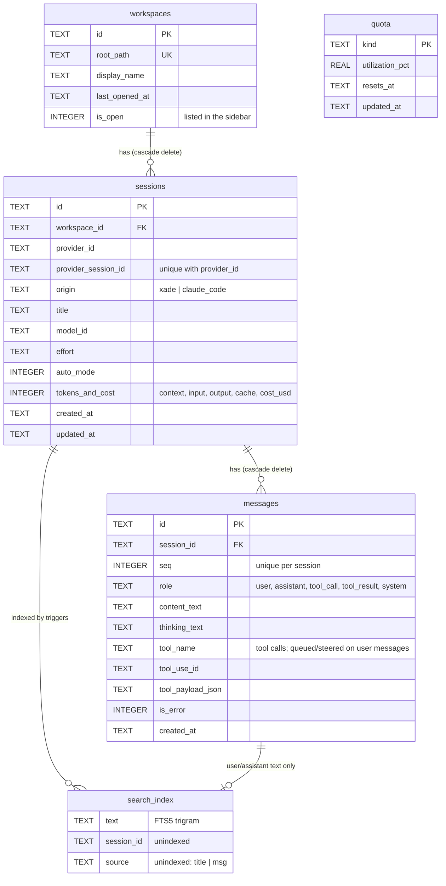
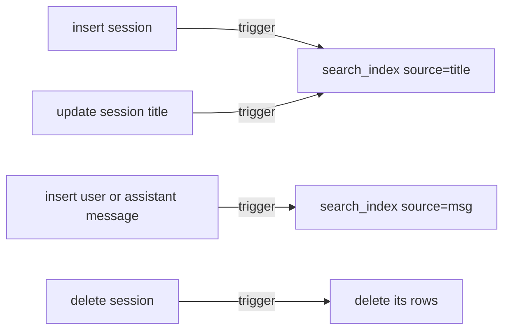
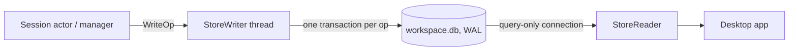

# Database architecture

Xade keeps all its state in one SQLite file, `workspace.db`, in the app data dir (`<data dir>/xade/`). The schema lives in `crates/store/src/schema.rs`; behavioural rules are in `wiki-llm/store.md`.

## Entity relationships

`quota` stands alone: one row per usage window kind, overwritten by the session actor on every quota event.

## Tables

| Table | Holds |
|---|---|
| `workspaces` | One row per project directory (`root_path` is unique). `is_open` decides what the sidebar lists. |
| `sessions` | One row per conversation: provider ids, model and effort, auto mode, token and cost totals, timestamps. `origin` tells Xade-created sessions from ones imported from Claude Code. |
| `messages` | The transcript: user prompts, finalized assistant blocks, tool calls and results. Streaming deltas are never stored. |
| `search_index` | FTS5 virtual table (trigram tokenizer), filled only by triggers. |
| `quota` | Last known usage window per kind (may be stale; check `resets_at`). |

## Search index

## Read and write paths

- One writer thread owns the only write connection; every `WriteOp` is its own transaction, and failures are logged, never fatal.
- Readers use a separate query-only connection; WAL mode lets them run beside the writer.
- Only the session actor creates message writes.

## Migrations

`PRAGMA user_version` holds the number of migrations applied. The writer applies the missing ones on open; a database newer than the code is an error.

| Version | Change |
|---|---|
| 1 | `workspaces`, `sessions`, `messages`, `search_index` and its triggers |
| 2 | `sessions.origin`, unique `(provider_id, provider_session_id)`, `quota` table |
| 3 | `workspaces.is_pinned` renamed to `is_open`; only the most recently opened workspace stays open |

## Conventions

- Ids are UUID text; timestamps are fixed-width UTC RFC3339 text.
- Deleting a workspace removes its sessions, and deleting a session removes its messages (foreign-key cascade); the `sessions_search_ad` trigger clears its search rows.
- Import upserts by `provider_session_id`, never touches `xade` origin rows, and skips sessions in temp directories.
