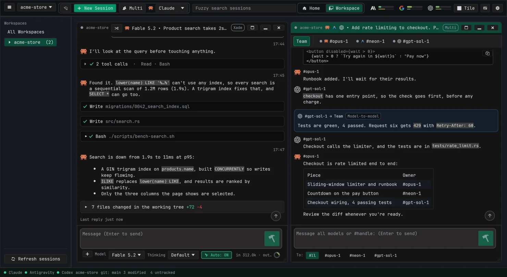
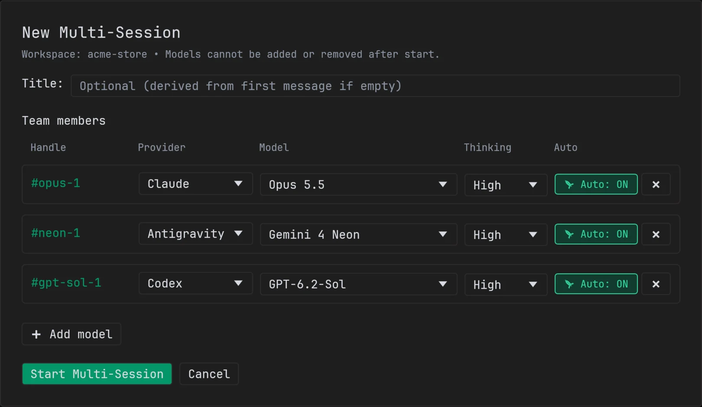
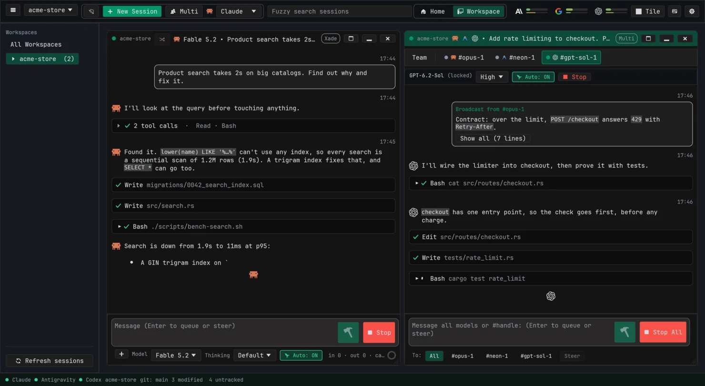

# Multi-Session

A Multi-Session is a team of models in one window, all working in the same folder. One can plan while others build and test, and they pass work to each other without you copying text between sessions.

## Start a team

Select a workspace in the sidebar, then click **Multi** in the top bar or press Cmd+Shift+T (Ctrl+Shift+T off macOS).

- Each row is one member: provider, model, thinking level and Auto. Members can mix providers, use only one, or repeat a model.
- Each member gets a handle from its model name and a number, such as `#opus-1`, `#sonnet-1` or `#opus-2`.
- The members and their models are fixed once the team starts. Thinking level and Auto can still be changed.
- The title is optional; without one, your first message names the team.
- **Auto starts on for every member.** Turn it off in the dialog to approve tool calls and review code changes before they are applied.

## Send messages

- A message goes to every member.
- Start it with `#handle:` to send it to one, for example `#opus-1: plan this and hand off the tests`. Typing `#` suggests handles, and the **To:** buttons under the box set the target.
- If a member is busy, your message follows the [`send_while_running` setting](settings.md#general-keys): it is queued, or it steers the running turn. Cmd+Shift+Enter does the other one.

## How the models talk

- A member's normal reply is shown only to you. Its teammates do not see it.
- To reach the team, a member wraps text in `<broadcast>...</broadcast>`. Every other running member receives it. The Team feed shows it in a bluish box marked **Model-to-model**.
- Xade explains these rules, and who is on the team, in each member's first prompt. It adds no tools or MCP servers to your CLIs. When to broadcast is each model's own call.
- A broadcast never interrupts a busy member. It waits until that turn ends, and several waiting ones arrive together.
- After 12 broadcast rounds without a message from you, delivery pauses. Click **Resume broadcasts** or send a message.

## Follow the work

- **Team** shows your messages, every reply and every broadcast, including replies still being written.
- Each **#handle** tab shows that member's own conversation with its tool calls and code changes. There you can change its thinking level or Auto, see how full its context is, and stop just that member. Cmd+Shift+A toggles Auto for the open tab.
- When a member waits for approval, the Team tab shows a **Review #handle** button.
- **Stop All**, or Cmd+period, stops every member and drops queued messages and broadcasts.

## Share one folder

All members work in the same working tree, with no separate copies or branches. Xade asks them to agree on who edits which files and who runs git, but it does not enforce it. Give each member its own part of the task.

Every member is a separate session with your provider, so a team uses quota faster than one session does.

## Saved teams

- A team is one card on Home, showing its members' handles. Its members are not listed on their own.
- Search covers the team's title, your messages and the broadcasts.
- Teams left open come back when Xade restarts, like other windows (see `restore_windows`).
- To rename a team, click its title.
- Deleting a team from its Home card also deletes its members' conversations from their providers.
- A member cannot be forked, renamed or deleted on its own.
